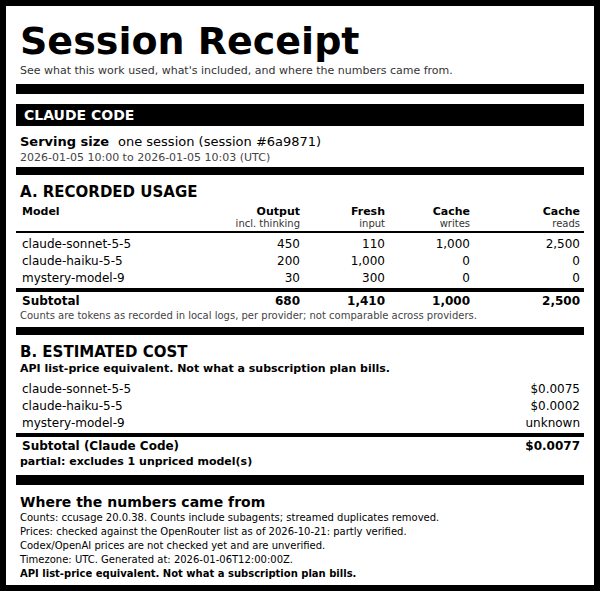

# Session Receipt v1

See what this work used, what's included, and where the numbers came from.



[Live demo](https://parttimediarybehavior.github.io/session-receipt/) with example HTML/SVG/JSON receipts (all synthetic), also available locally at [`docs/index.html`](docs/index.html).
Regenerate the examples with `python3 examples/build_docs.py --png`.

A local command-line tool that turns your Claude Code (and, experimentally, Codex) usage logs
into a nutrition-label style receipt: recorded token usage, an API-equivalent cost estimate,
and (optionally) illustrative environmental scenarios. Accounting is plain deterministic code.
There are no model calls, and receipts make no network calls (installing downloads ccusage from
the npm registry once; `update-prices` downloads the price list, only when you run it).

## Install

You need Python 3.10 or later and Node.js (which includes npm). There is no `pip install` and no
virtual environment to set up, except that on Windows Python also needs the `tzdata` package.

### As a Claude Code plugin

In Claude Code 2.1.275 or later:

```
/plugin install session-receipt --marketplace parttimediarybehavior/session-receipt
```

On older versions:

```
/plugin marketplace add parttimediarybehavior/session-receipt
/plugin install session-receipt@session-receipt
```

Claude Code installs the pinned ccusage 20.0.38 (MIT) with the plugin. Then ask Claude for a
receipt, or run `/session-receipt:receipt`. If something is missing, the skill runs
`session-receipt doctor`, which checks Python, the time zone database and ccusage, and prints the
exact fix for each problem. On Windows the first run usually asks for one extra command, which
adds `tzdata` to your Python (see [Windows](#windows)).

The plugin has no version number, so every new commit is an update. Turn on auto-update for the
`session-receipt` marketplace in `/plugin`, or run `claude plugin update session-receipt@session-receipt`.
Remove it with `claude plugin uninstall session-receipt@session-receipt`.

### Without the plugin

One line on macOS and Linux:

```
git clone https://github.com/parttimediarybehavior/session-receipt.git && npm ci --prefix session-receipt && session-receipt/bin/session-receipt doctor
```

One line on Windows (PowerShell):

```
git clone https://github.com/parttimediarybehavior/session-receipt.git; npm ci --prefix session-receipt; session-receipt\bin\session-receipt.cmd doctor
```

Then run `session-receipt/bin/session-receipt` (on Windows, `session-receipt\bin\session-receipt.cmd`),
or add that `bin` folder to your PATH. To try it with synthetic data:
`session-receipt/bin/session-receipt demo --out sr_demo --now 2026-01-06T12:00:00Z`. To remove it,
delete the folder.

### For development

```
git clone https://github.com/parttimediarybehavior/session-receipt.git
cd session-receipt
npm ci
python3 -m venv .venv && .venv/bin/pip install -e .
python3 -m unittest discover -s tests
```

No wheel is published. The code uses the Python standard library only (plus `tzdata` on Windows).
ccusage ships a native binary per platform (darwin/linux/win32, x64/arm64); **only Linux x64 and
Windows 10 x64 have been tested on real logs** (Windows by hand on one machine; CI on Windows
uses synthetic fixtures only; see [Windows](#windows)). For an offline machine, run `npm ci`
elsewhere and copy `node_modules/` across, or point `SESSION_RECEIPT_CCUSAGE` at an existing
ccusage 20.0.38. Nothing is written outside the project folder except receipts where you ask for
them, the optional price-check cache in `~/.cache/session-receipt/` (or
`$SESSION_RECEIPT_CACHE_DIR`), and the automatic receipts described under
[Claude Code plugin](#claude-code-plugin).

### Windows

- Windows has no IANA time zone database, so Python needs the `tzdata` package. `session-receipt
  doctor` prints the exact command for the Python it uses, for example
  `"C:\Users\Jane Doe\AppData\Local\Programs\Python\Python313\python.exe" -m pip install --user tzdata`.
  A development install (`pip install -e .`) adds it for you.
- Pass `--tz`: there is no `/etc/timezone`, so the default is `UTC` unless `TZ` is set.
- ccusage runs as the native `ccusage.exe` that npm installed under `node_modules/@ccusage/`.
  npm picks the build for your Node.js (`process.arch`), which on Windows on Arm can differ from
  your Python. If Python reports ARM64, the ARM64 build is used, or else the x64 build (Windows 11
  on Arm runs x64 under emulation). If Python reports x64, only the x64 build is used; an ARM64
  build is never picked. (Python 3.12+ reports the CPU; an x64 Python 3.10/3.11 running under
  emulation on Arm reports x64.) If none fits, the error names what is installed: rerun `npm ci`
  with a Node.js built for this machine, or set `SESSION_RECEIPT_CCUSAGE` to a ccusage executable.

Automatic receipts (the SessionEnd hook, below) on Windows: opt in from PowerShell. The hook runs
the CLI that came with it, so nothing else needs setting up:

```
New-Item -ItemType Directory -Force "$HOME\.config\session-receipt" | Out-Null
New-Item -ItemType File -Force "$HOME\.config\session-receipt\auto-enabled" | Out-Null
```

To run a different copy instead, set `SESSION_RECEIPT_CMD` to a JSON array, for example
`[Environment]::SetEnvironmentVariable("SESSION_RECEIPT_CMD", (ConvertTo-Json -InputObject @("C:\Users\Jane Doe\sr\.venv\Scripts\session-receipt.exe") -Compress), "User")`,
then close and reopen your terminal app: a user environment variable reaches only processes
started after it is set.

- The hook runs through Claude Code's shell (Git Bash) with the first of `python3`, `python` and
  `py -3` that is Python 3.10 or later. The python.org installer provides `python` and `py` but no
  `python3`. A `python3` in `WindowsApps` is either a real Microsoft Store Python or a stub that
  only prints a message; the hook skips a stub. If none of them starts, the hook exits 1 and
  writes no receipt and no `hook.log`.
- The hook command is written for Git Bash, which Claude Code uses as its shell on Windows when
  Git for Windows is installed. Without Git Bash, Claude Code runs hooks in PowerShell, and the hook
  does not run.
- The hook detaches with `DETACHED_PROCESS | CREATE_NEW_PROCESS_GROUP`, plus `CREATE_BREAKAWAY_FROM_JOB`
  when its job allows it (it retries without breakaway otherwise). Windows CI runs the hook inside
  real kill-on-close job objects that are closed as soon as the hook returns. With the kind libuv
  (Node's process layer) gives each child it spawns, which has `SILENT_BREAKAWAY_OK`, the worker
  survives. With a job that forbids breakaway, the hook falls back, and the worker runs while the
  job stays open but is killed when it closes. The case in between (breakaway allowed, not silent),
  where `CREATE_BREAKAWAY_FROM_JOB` is what saves the worker, is skipped on GitHub's runners because
  their own job forbids breakaway, so it is untested. Which kind of job Claude Code uses has not
  been checked directly. In real Claude Code sessions on one Windows machine (Windows 10 22H2
  x64, Claude Code 2.1.302), the worker wrote its receipt both after `/exit` and after the terminal window
  was closed.

## Try it with no real logs

```
python3 -m session_receipt demo --out /tmp/sr_demo --now 2026-01-06T12:00:00Z
```

This builds synthetic fixtures (fake paths, fake content) and renders HTML, SVG and JSON.

## Report on real usage

```
python3 -m session_receipt session --latest --tz America/New_York
python3 -m session_receipt session --id <id-or-prefix-or-6hex> --env
python3 -m session_receipt daily --date 2026-10-20 --tz America/New_York --source both
python3 -m session_receipt pricecheck
```

Options: `--source claude|codex|both`, `--format html,svg,json`, `--out DIR` (default `./receipts/`),
`--env`, `--private`, `--now ISO`, `--claude-dir` (a dir containing `projects/`),
`--codex-home`. `--latest` means the most recent last activity within today and yesterday
(or `--since/--until`). A missing session exits non-zero with a message.

## Offline

ccusage always runs with `--offline` (bundled price table). Making a receipt fetches nothing.
Your logs are only read, never modified.

## Prices: a dated snapshot, refreshed on request

```
python3 -m session_receipt update-prices            # downloads https://openrouter.ai/api/v1/models once
python3 -m session_receipt update-prices --from models.json   # or use a saved copy
```

This writes three files under `pricing/`, all stamped with the download date:
`openrouter-snapshot.json` (the published Anthropic and OpenAI entries), `reference.json`
(Claude rates per MTok, including long-prompt tiers) and `ccusage-overrides.json`. It then
measures ccusage's built-in rate for every Claude model against the snapshot. Where they
disagree it writes an override, so receipts are costed at the snapshot's prices. Models with a
long-prompt tier are never overridden, because a flat override would erase the tier; a
disagreement there stays on the receipt as a warning. The receipt footer says
"checked against the OpenRouter list as of <date>". Prices are only as current as the last
`update-prices`. On 2026-10-21, ccusage agreed with OpenRouter on all 15 Claude models and all
five rate types, so no overrides were needed. OpenRouter passes Anthropic's list prices through;
a spot check against Anthropic's pricing page that day agreed. The tool never writes under `~/.claude` or `~/.codex`.

## How to read the receipt

- **A. Recorded usage**: tokens per model as recorded: output (including thinking/reasoning),
  fresh input, cache writes, cache reads. Each provider has its own block and subtotal;
  there is deliberately no cross-provider grand total because token semantics differ.
- **B. Estimated cost**: tokens times list prices. It is an API-equivalent estimate, not what a
  subscription plan bills. An unpriced model reads "unknown" (never $0) and the subtotal says
  "partial: excludes N unpriced model(s)".
- **C. Optional environmental scenarios** (only with `--env`): LOW / CENTRAL / HIGH for kWh,
  litres of water and kg CO2e. These are illustrative scenarios built from cited estimates and
  flagged assumptions. None is measured and they are not bounds. Sources: `session_receipt/SOURCES.md`.
- **Where the numbers came from**: ccusage version, price table date and check status, timezone,
  generation time. Counts include subagents; streamed duplicates are removed.
- **PROVISIONAL** appears when the last activity is within 2 minutes of generation time, or the
  window includes today.
- **Price check**: `pricecheck` measures the rates ccusage actually applies (five probe
  fixtures per model) and compares them with `pricing/reference.json`. Mismatches are marked
  with a warning sign and a footnote.

## Privacy defaults

Public export is the default. It omits prompt/response content (ccusage never emits it, and
the tool refuses output containing such fields), usernames, filesystem paths (project path,
cwd, directory), and raw session IDs (shown as `session #<first 6 hex of sha256(id)>`).
`--private` keeps the project path and full session ID for local use only. Model names are
always escaped before they reach HTML or SVG.

## Supported / not supported in v1

- Session and daily receipts for Claude Code: supported.
- Concurrent sessions are kept separate by session id. Subtracting machine-wide totals is never
  used for attribution (it is wrong when sessions overlap).
- Codex: **experimental**. Works with synthetic rollouts in tests (ccusage reads `CODEX_HOME`).
  Per-model cost is shown only when a session used one model; otherwise only the session cost.
  Codex prices are not checked against the snapshot yet, so they read "unverified". A model
  ccusage cannot price reads "unknown" and the subtotal is partial (or unknown if no model in
  it is priced). Allocating cost across models is never guessed.
- **Turn-level attribution: not supported.** Usage is recorded per streamed API message, not
  per user turn; a turn spans several messages and subagents, and ccusage exposes no turn
  boundaries. Task attribution across sessions is also out of scope.
- The 5-minute vs 1-hour cache-write split is not exposed by ccusage's JSON; the price check
  verifies the 1h rate with a probe but receipts show one cache-write column.
- Long-prompt tiers (e.g. haiku-5-5 above 100K) are applied by ccusage and recorded in the
  reference, but the price check probes only the standard tier.

## Claude Code plugin

The repository is itself a Claude Code plugin and its own marketplace (see [Install](#install)). It has:

- a `/session-receipt:receipt` skill: asks Claude to run this CLI for the current session
  (`${CLAUDE_SESSION_ID}`), today, or a date. Claude reports what the CLI printed; it does not
  count anything itself. A receipt for the *current* session is provisional: it cannot include
  the reply that reports it.
- an optional **SessionEnd** hook that writes a receipt when a session ends. It is **inert unless
  you opt in**: `mkdir -p ~/.config/session-receipt && touch ~/.config/session-receipt/auto-enabled`
  (or `SESSION_RECEIPT_AUTO=1`). `touch ~/.config/session-receipt/disabled` always turns it off.
  The hook returns in milliseconds and does the work in a detached process that first waits for
  the transcript to stop changing. It never calls a model or starts Claude Code, so it cannot
  trigger a turn; a nested-run guard (`SESSION_RECEIPT_IN_HOOK`) stops recursion. Receipts and
  `hook.log` go to the plugin data dir (`$CLAUDE_PLUGIN_DATA`) or `~/.local/share/session-receipt/`.
  The hook itself runs with the first of `python3`, `python` and `py -3` that is Python 3.10 or
  later, and runs the CLI that came with it. To run a different copy, set `SESSION_RECEIPT_CMD`,
  which is never run through a shell. It is read by its syntax alone, never by which files exist,
  as one of:
  - a JSON array of strings (recommended; any part may contain spaces):
    `["/opt/my tools/python3", "-m", "session_receipt"]`
  - the whole value in double quotes: one executable path, spaces allowed, no arguments:
    `"C:\Users\Jane Doe\session-receipt\.venv\Scripts\session-receipt.exe"`
  - one word: an executable name or a path without spaces: `/opt/sr/bin/session-receipt`
  - several words whose first word is not an absolute path, split on spaces: `python3 /opt/sr/cli.py`

  Anything else is refused and nothing runs. That includes an absolute path followed by more words,
  which could be one path with spaces, and quotes that do not wrap the whole value. **Migration:**
  the earlier form `/usr/bin/python3 /opt/sr/cli.py` (an absolute path plus arguments) is now
  refused. Write it as `["/usr/bin/python3", "/opt/sr/cli.py"]`. A refused value, or an executable
  that cannot start (for example, a quoted path that does not exist), is logged to `hook.log`.

- a `bin/session-receipt` launcher, which Claude Code puts on the Bash tool's PATH. It runs the CLI
  from the plugin folder with no `pip install`.

Try a checkout without installing: `claude --plugin-dir .` from the project folder (run `npm ci`
there first). Remove it by dropping that flag. The plugin never edits your settings or hooks.

Codex: no skill or hook is provided. Codex *reports* (above) are a separate capability from
any automatic Codex integration, which is not built.

## Evidence on real logs

Before release, the counts were reconciled on one machine's real logs (not included here):
an independent counter (dedup by message id + request id, keep the largest output, all
`projects/**/*.jsonl` including subagents) agreed with this tool field by field for a full day
of Claude Code usage, and direct counting of a Codex rollout's `token_count` events matched
ccusage's Codex figures. One lesson from that check: an early build "corrected" the sonnet-5-5
cache-read price from an out-of-date document; Anthropic's pricing page and the OpenRouter list
both give $0.10/MTok (0.05x input), so ccusage was right. Prices are now checked against a dated
snapshot (see above) rather than a hand-written table.

## Tests

```
python3 -m unittest discover -s tests -v
```

Tests use synthetic fixtures only, generated into a temp dir at test time (`examples/make_fixtures.py`,
compact JSON because ccusage silently ignores non-compact lines). On Windows, which forbids `<` and `>`
in file names, the hostile-path fixture uses `&` and `'` instead of ``.
